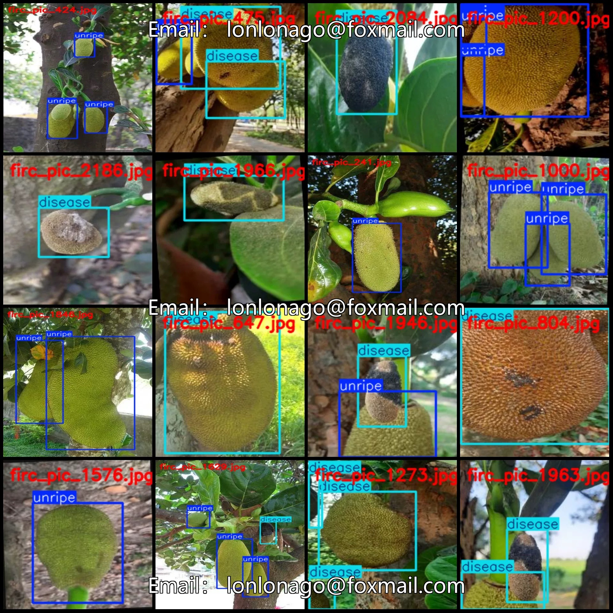
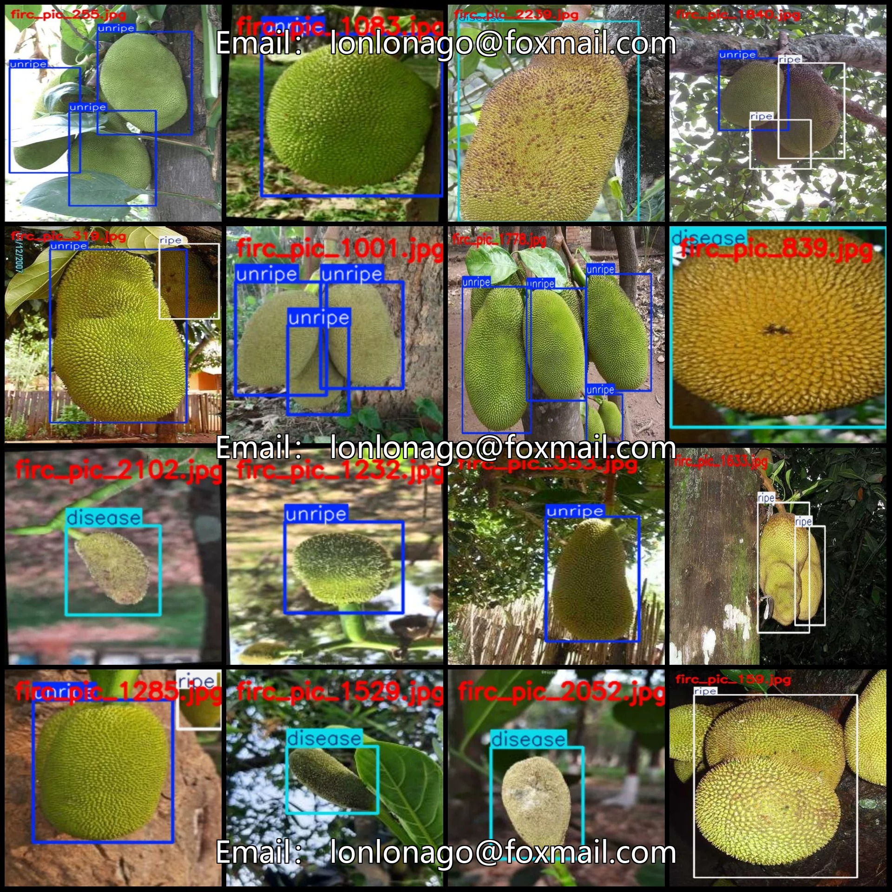
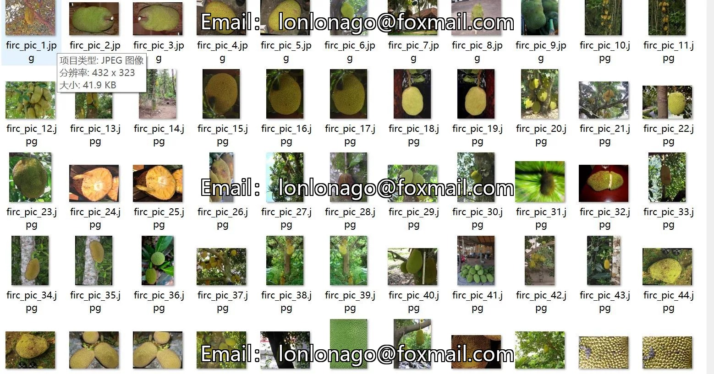
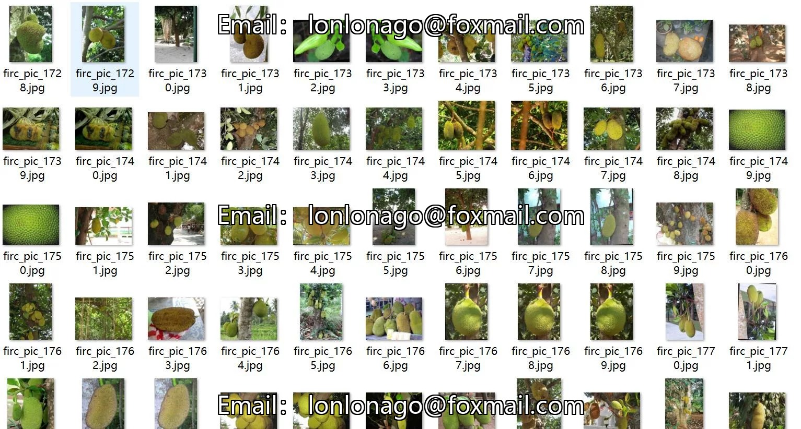
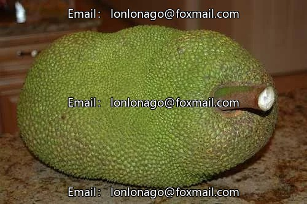
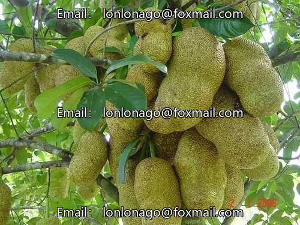
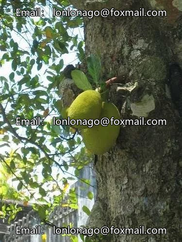

# Pineapple Melon Maturity Detection Dataset VOC+YOLO format with 2355 images in 3 categories

## Body

Pineapple ripeness detection dataset VOC+YOLO format with 2355 images in 3 categories
Tips: Due to the dataset's replicability, please confirm compliance before purchasing.
Dataset format: Pascal VOC format + YOLO format (txt file without split path, only containing jpg images and corresponding VOC format xml files and yolo format txt files)
Number of images (number of jpg files): 2355
Number of annotations (number of xml files): 2355
Number of annotations (number of txt files): 2355
Number of annotation categories: 3

Label categories with names (Note that the order of labels in YOLO format does not correspond to this, but refer to the 'labels' folder and its 'classes.txt' file): ['disease', 'ripe', 'unripe']
Number of boxes per category and number of images they occupy:
- Disease: 1104 boxes, 931 images
- Ripe: 1418 boxes, 497 images
- Unripe: 3964 boxes, 1257 images
Total boxes: 6486
Image resolutions: Multiple resolutions, such as 224x224, 500x333, etc.
Labeling tool used: labelImg
Labeling rules: Draw a box around each category.

Important Notice: The dataset does not have separate training, validation, and test sets; you need to partition them yourself.
Special : This dataset does not guarantee the accuracy of the trained models or weight files.

## Images

## Payment

Here is a pay link on Stripe ( https://buy.stripe.com/3cs8yP7sY87d0vu9AB ). Please contact me lonlonago@foxmail.com after funding $89, and I will send you a complete data files , thank you!

